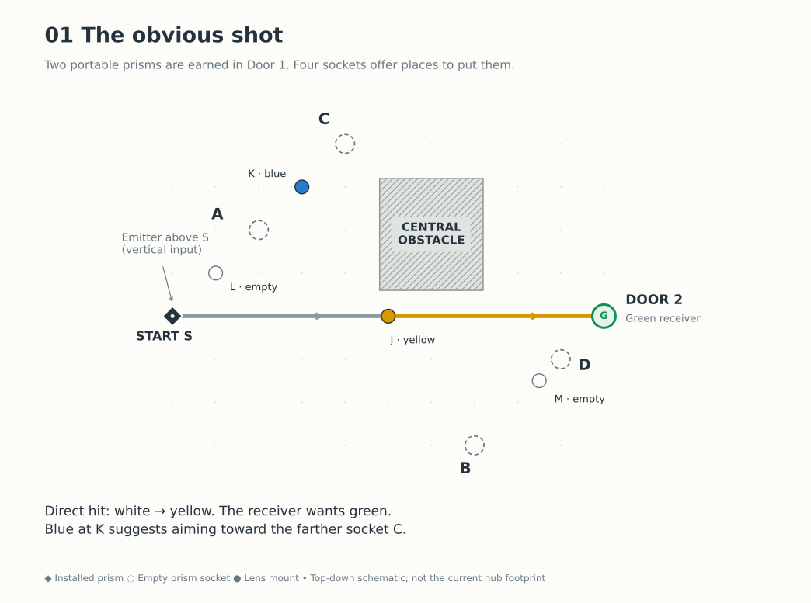
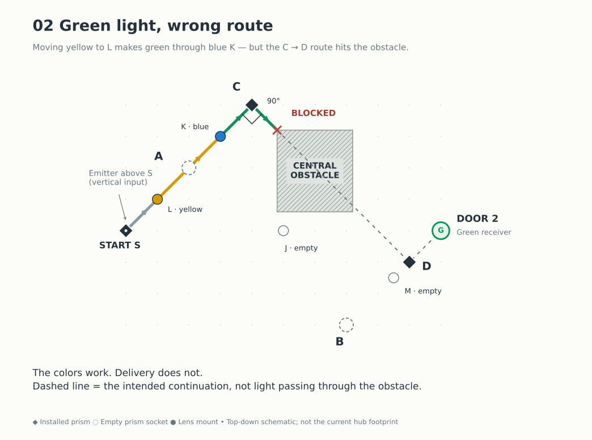
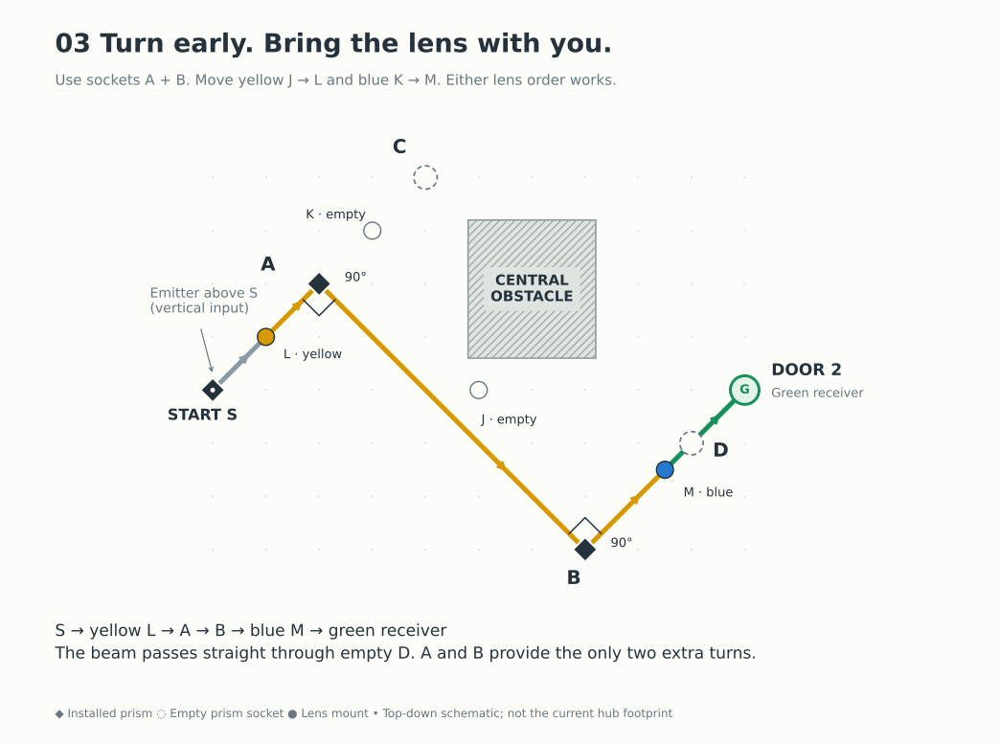

# Prism connector: turn early, move the lens

Design proposal, November 16, 2026. The first playable blockout is now implemented
in [Refraction Hall](../godot/scenes/escape/README.md), with separate side rooms,
one-item carrying, and the Egypt reward reveal. Geometry and integration are
checked; player difficulty still needs playtesting. These diagrams use abstract
coordinates; the implementation now uses 0.72× scale with origin (3.58, -1.72)
in the hall's east-side bay. The receiver is mounted on Door 2's north jamb,
leaving the center of the shared hall available for future puzzles.

## Recommended ingredients

- One white emitter directly above the installed starting prism S.
- Two portable prisms earned by completing Door 1's pyramid puzzle.
- Four empty prism sockets: A, B, C, D.
- Two portable lenses, yellow and blue; four dedicated lens mounts J, K, L, M.
- One opaque central obstacle, taller than the horizontal beam.
- One green receiver at Door 2, directly visible from S.

All prisms bend light exactly 90 degrees. The ceiling emitter is essential: S turns
vertical input into horizontal output, so rotating S can change its horizontal
heading without breaking that rule. Portable prisms rotate horizontally only.

With a coplanar fixed emitter, S could only send light in two opposite directions.
Two additional right-angle turns cannot detour away from and return to that line.
The overhead source solves this constraint without adding a prism or a reflector.

## Initial arrangement

S initially points directly at Door 2 through yellow lens J. The receiver responds
to the beam, but it needs green. Blue lens K sits on the diagonal toward far socket
C. The nearer socket A lies on that same diagonal, before the blue lens.

L and M are empty lens mounts. A, B, C and D start without prisms. Door 1 is open.
The player can learn the color rule before collecting the reward, but cannot
deliver green light to the receiver without both portable prisms.

## Tempting incomplete solution

Move yellow from J to L, and aim S northeast. The light passes through yellow L
and existing blue K, making green. This points toward socket C and makes C look
like an attractive first turn. With prisms at C and D, both proposed turns are
exactly 90 degrees, but the C-to-D segment crosses the obstacle. The actual beam
ends at the obstacle with a visible impact. The diagram's dashed line is only the
designer's intended continuation, not transmitted light.

This is useful partial progress: the player has discovered the right color and
has placed one lens in a useful location. The obstacle rejects the route, not
their understanding of the color rule.

## Solution and realization

Place the two portable prisms at A and B. Move yellow J to L and blue K to M:

**S → yellow L → A → B → blue M → green receiver.**

The colors can be exchanged between L and M; order is not a puzzle rule. The two
portable turns are northeast-to-southeast and southeast-to-northeast.

The key realization is that the first turn must happen at A, before reaching
the initial blue lens. Move the lens onto the route that can reach the receiver.
Empty D lies on the final approach and must let the beam pass straight through.

## Other decisions and feedback

| Attempt | Result | Information |
| --- | --- | --- |
| S directly to receiver | White, yellow, or blue; never green | Only one lens mount lies on the shortcut |
| C then D | Valid turn angles, obstructed middle segment | Green light still needs a deliverable route |
| A then D | Required outgoing direction is not perpendicular | Visibility alone does not make a connection legal |
| C then B | Required outgoing direction is not perpendicular | Incoming direction constrains the next turn |
| S straight toward B | B cannot turn 90 degrees into the receiver | A nearby final socket is not enough |
| A then B, leaving blue at K | Beam misses blue because A turns earlier | The lens must move, not just the prisms |

Do not force these attempts or prescribe their order. Players who see the solution
immediately should be allowed to build it. Snapping should expose legal 90-degree
directions, not offer an impossible arbitrary target and silently bend the rule.
Show the outgoing ray even when it hits a wall or has no useful target.

## Coordinates and geometry check

Coordinates are arbitrary units, positive Y north. The canonical data is
[`prism-layout.json`](prism-layout.json).

| Element | X | Y | Initial state |
| --- | ---: | ---: | --- |
| S | 0 | 0 | Fixed starting prism; white input from above |
| Receiver | 10 | 0 | Green target |
| A | 2 | 2 | Empty prism socket |
| B | 7 | -3 | Empty prism socket |
| C | 4 | 4 | Empty prism socket |
| D | 9 | -1 | Empty prism socket |
| J | 5 | 0 | Yellow lens |
| K | 3 | 3 | Blue lens |
| L | 1 | 1 | Empty lens mount |
| M | 8.5 | -1.5 | Empty lens mount |

Obstacle bounds: X = 4.8–7.2, Y = 0.6–3.2.

An enumeration of all 17 ordered socket sequences using zero, one or two portable
prisms found three angle-valid routes: the direct shot, A–B, and C–D. C–D intersects
the obstacle at (4.8, 3.2) and then crosses its interior. A–B clears it. None of the
four single-socket routes has the required right-angle turn.

Across the 21 legal placements of the two lenses into four mounts or inventory,
the only winning configurations are A–B with lenses at L/M, in either color order.
At A, incoming (2,2) and outgoing (5,-5) have dot product zero. At B, incoming
(5,-5) and outgoing (3,3) also have dot product zero.

These checks use point optics and exact geometry. They do not establish difficulty,
collision margins, or fit in the current room. Those require a playable blockout.

## Rules the blockout must preserve

- Empty prism sockets and empty lens mounts transmit straight through. Their
  physical geometry must sit below or around the beam rather than occluding it.
- Installed prisms intercept the beam; neither straight transmission nor splitting
  is an extra prism mode. There is only one outgoing beam.
- One lens per mount. Carried lenses have no optical effect. No stacking or free
  positioning in the direct beam, which would bypass the routing puzzle.
- Lenses auto-orient in their fixed mounts. All horizontal optics share a height;
  portable prisms cannot pitch the beam above the obstacle.
- The receiver accepts both the direct and diagonal arrivals. Do not add a narrow
  hood that accidentally rejects the solution angle.
- White through yellow and blue produces green in either order, using the agreed
  magical color rule. Symbols and immediate beam changes teach it in the game.
- Preserve arrangements when entering or leaving Door 1; permanently unlock Door 2
  after success. Make missing reward prisms recognizable without resetting progress.

## Alternatives considered

Three independent agent passes explored and audited this design. A six-socket
variant added a second obstructed route; a five-socket variant placed blue on a
separate lower branch. The four-socket version is preferred because it can produce
green on the tempting route before revealing the delivery problem, and requires
turning before the very lens that initially attracted the player.

The current puzzle should be a short connector, not a long routing maze. Add more
sockets only if playtesting shows a specific missing decision. The next step is
to fit this topology into a simple playable blockout and observe whether players
notice that lenses are movable and understand the early-turn solution.
